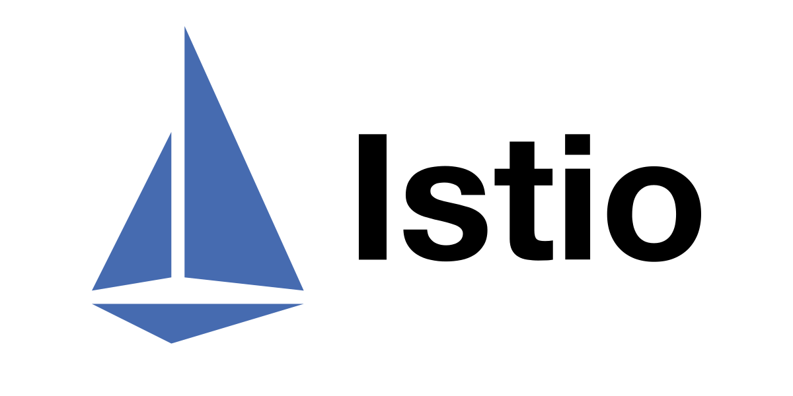

# Steadybit extension-istio

This [Steadybit](https://www.steadybit.com/) extension enables the injection of HTTP and gRPC faults into [Istio's virtual services](https://istio.io/latest/docs/reference/config/networking/virtual-service).

Learn about the capabilities of this extension in our [Reliability Hub](https://hub.steadybit.com/extension/com.steadybit.extension_istio).

## Istio ambient mode

The extension was built for sidecar mode and has limited use in
[ambient mode](https://istio.io/latest/docs/ambient/overview/):

- Fault injection is a layer 7 feature. In ambient mode it is only enforced by a
  [waypoint proxy](https://istio.io/latest/docs/ambient/usage/waypoint/). For a workload without a
  waypoint, the attack modifies the virtual service but the fault has **no effect** on traffic.
- Istio's support for `VirtualService` on waypoints is alpha, and a virtual service must not be combined
  with an `HTTPRoute` for the same service.
- Ambient meshes usually route with the Gateway API (`HTTPRoute`, `GRPCRoute`). The extension only
  discovers `VirtualService` resources, so such a mesh shows no targets.
- The *source labels* filter of the attacks relies on sidecar semantics and may not match as expected
  on a waypoint.

## Configuration

| Environment Variable                                                | Helm value                                     | Meaning                                                                                                                | Required | Default |
|---------------------------------------------------------------------|------------------------------------------------|------------------------------------------------------------------------------------------------------------------------|----------|---------|
| `STEADYBIT_EXTENSION_CLUSTER_NAME`                                  | `kubernetes.clusterName`                       | Kubernetes cluster name.                                                                                               | yes      |         |
| `STEADYBIT_EXTENSION_DISCOVERY_ATTRIBUTES_EXCLUDES_VIRTUAL_SERVICE` | `discovery.attributes.excludes.virtualService` | List of Target Attributes which will be excluded during discovery. Checked by key equality and supporting trailing "*" | false    |         |

Beyond the settings above, this extension supports the configuration common to all Steadybit
extensions:

- [extension-kit](https://github.com/steadybit/extension-kit#environment-variables) — HTTP and
  health ports, TLS and mutual TLS, unix domain socket, logging, and pprof.
- [Target Filtering](https://github.com/steadybit/discovery-kit/blob/main/docs/target-filtering.md) —
  stop the extension reporting targets you do not want.
- [Group Matching](https://github.com/steadybit/discovery-kit/blob/main/docs/target-enrichment.md#group-matching) —
  tag discovered targets with a group, so enrichment rules only match within it.

## Installation

### Kubernetes

Detailed information about agent and extension installation in kubernetes can also be found in
our [documentation](https://docs.steadybit.com/install-and-configure/install-agent/install-on-kubernetes).

#### Recommended (via agent helm chart)

All extensions provide a helm chart that is also integrated in the
[helm-chart](https://github.com/steadybit/helm-charts/tree/main/charts/steadybit-agent) of the agent.

You must provide additional values to activate this extension.

```
--set extension-istio.enabled=true \
--set extension-istio.kubernetes.clusterName=my-cluster \
```

Additional configuration options can be found in
the [helm-chart](https://github.com/steadybit/extension-istio/blob/main/charts/steadybit-extension-istio/values.yaml) of the
extension.

#### Alternative (via own helm chart)

If you need more control, you can install the extension via its
dedicated [helm-chart](https://github.com/steadybit/extension-istio/blob/main/charts/steadybit-extension-istio).

```bash
helm repo add steadybit-extension-istio https://steadybit.github.io/extension-istio
helm repo update
helm upgrade steadybit-extension-istio \
    --install \
    --wait \
    --timeout 5m0s \
    --create-namespace \
    --namespace steadybit-agent \
    --set kubernetes.clusterName="my-cluster" \
    steadybit-extension-istio/steadybit-extension-istio
```

## Extension registration

Make sure that the extension is registered with the agent. In most cases this is done automatically. Please refer to
the [documentation](https://docs.steadybit.com/install-and-configure/install-agent/extension-registration) for more
information about extension registration and how to verify.

## Version and Revision

The version and revision of the extension:
- are printed during the startup of the extension
- are added as a Docker label to the image
- are available via the `version.txt`/`revision.txt` files in the root of the image
